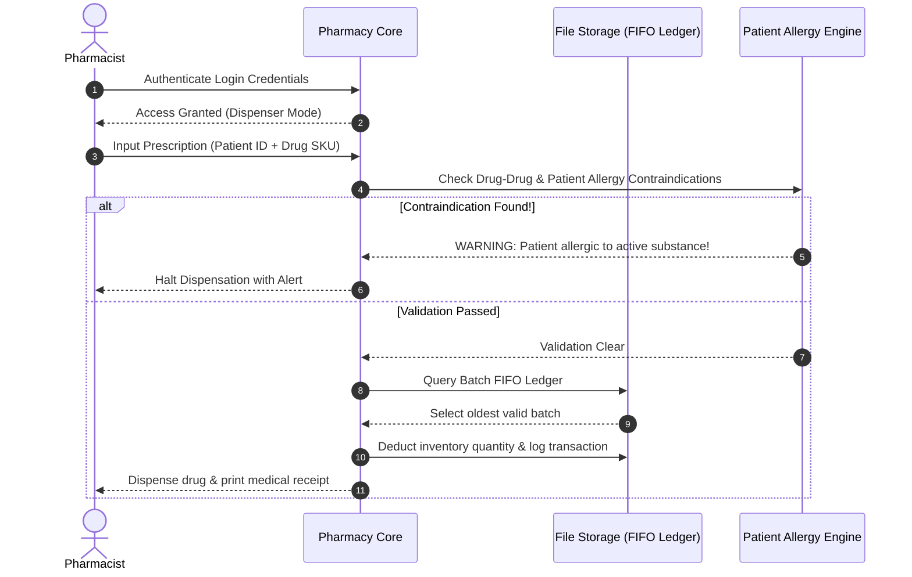

# 💊 Modern Pharmacy Management & Dispensing System in C++

[](https://isocpp.org/)
[](LICENSE)
[](#)

A dedicated healthcare software solution and pharmacy information system designed in modern **C++**. Authored by **Ammar Abdelfattah** for the **Object-Oriented Programming and Software Engineering** curriculum at **Faculty of Engineering – New Ismailia National University (NINU)**.

---

## 📌 Domain Overview & Architecture

Operating a pharmaceutical dispensary demands strict inventory controls, active-substance indexing, patient prescription recordkeeping, and regulated medicine dispensation. This project provides an architecture with:

1. **Pharmaceutical Data Hierarchy**:
   - `Medicine` (Base class): SKU, Commercial Name, Scientific Active Ingredient (Generic Name), Dosage Form (Tablets, Syrup, Injection, Ointment), Concentration, Manufacturer, Batch Number.
   - `PrescriptionMedicine`: Subclass introducing Schedule/Controlled Drug classifications, prescribing physician registration, and dispensing restrictions.
   - `OTC_Medicine` (Over-the-Counter): Consumer products eligible for direct dispensation.
2. **Customer & Patient Registry**:
   - Patient profiling tracking known allergies, chronic conditions, and previous purchase histories to alert against negative drug-drug interactions.
3. **Inventory & Expiration Ledger**:
   - First-In, First-Out (**FIFO**) batch inventory management ensuring older batches are dispensed before newer shipments.
   - Automated expiration notification alerts for batches expiring within 30, 60, or 90 days.
4. **Billing & Prescription Audit Logs**:
   - Itemized invoicing with healthcare insurance discount percentages.
   - Complete audit trail written to disk for state regulatory compliance.

---

## 🏗️ System Workflow



---

## 🛠️ Build & Installation

```bash
# Clone the repository
git clone https://github.com/marbdalftah72-spec/Pharmacy-Management-System-CPP.git
cd Pharmacy-Management-System-CPP

# Build using g++
g++ -std=c++17 -Wall -Wextra src/*.cpp -I include -o PharmacyApp

# Launch application
./PharmacyApp
```

---

## 👨‍💻 Author

- **Ammar Abdelfattah**
- Faculty of Engineering, **New Ismailia National University (NINU)**
